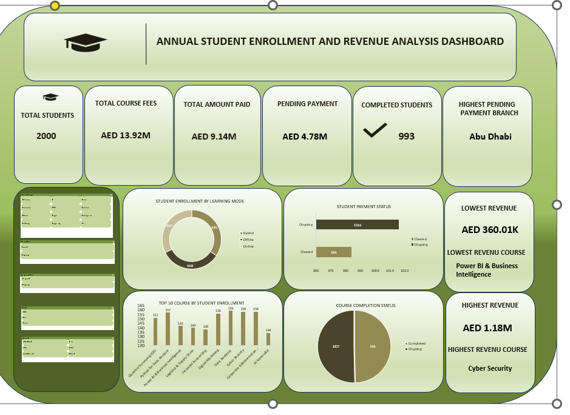

# Student Enrollment & Revenue Analysis – Excel

## Project Overview

This project focuses on analyzing student enrollment and revenue data using Microsoft Excel. An interactive dashboard was developed to understand course enrollment, fee collection, and pending payments.

## Project Objectives

- Analyze student enrollment.
- Evaluate course fees.
- Track total fees paid by students.
- Identify pending payments.
- Present insights through an interactive dashboard.

## Tools & Technologies

- Microsoft Excel
- Pivot Tables
- Pivot Charts
- Slicers
- KPI Cards

## Key Analysis

- Total Student Enrollment
- Course Fee Analysis
- Total Fees Collected
- Pending Payments
- Course Performance

## Dashboard Preview

## Project Files

- Excel workbook – Student enrollment and revenue analysis.
- `STUDENT-DASHBOARD.png` – Dashboard screenshot.

## Conclusion

The dashboard provides insights into student enrollment, course fees, collected payments, and pending payments. It helps evaluate enrollment and revenue performance through interactive visualizations.
